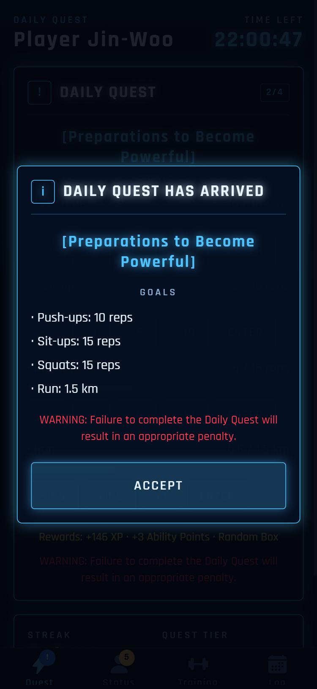
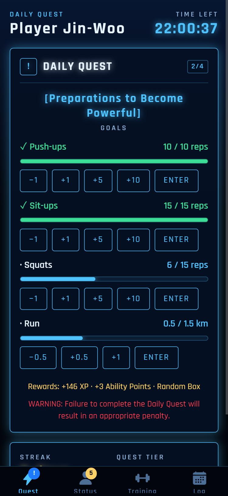
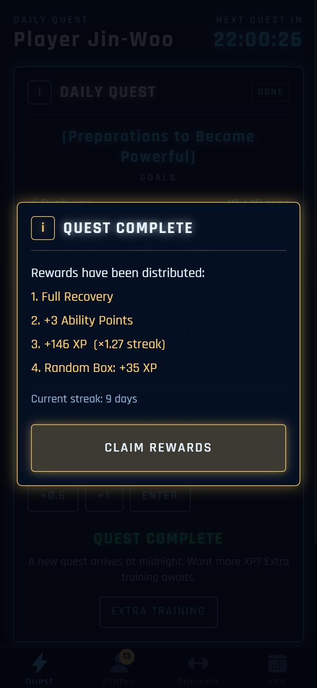
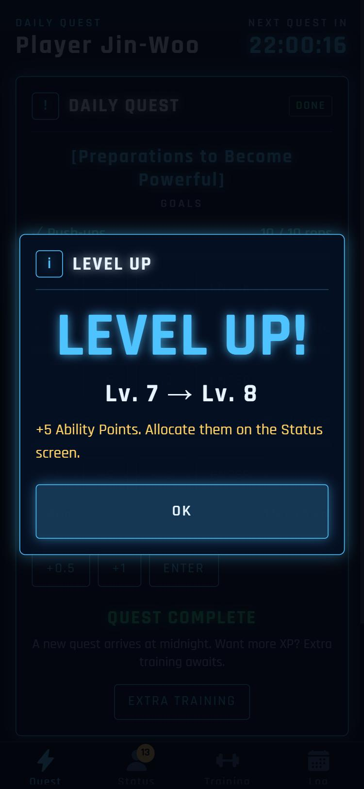
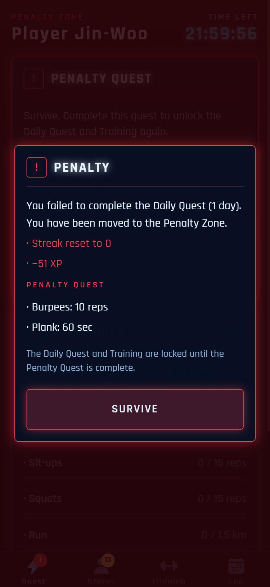
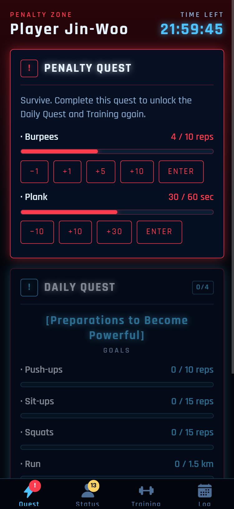
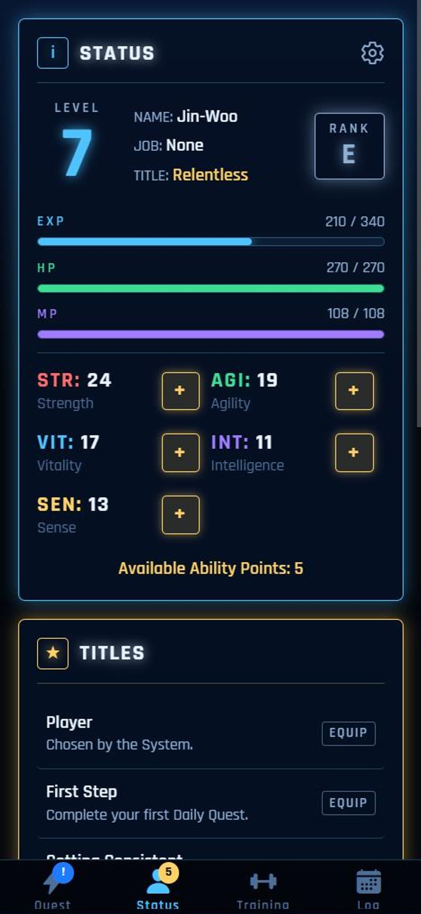
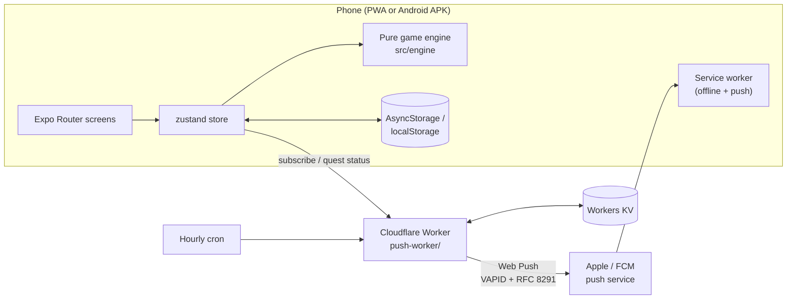

# SYSTEM — a Solo Leveling–style daily workout quest

> **[Daily Quest: Preparations to Become Powerful has arrived.]**
> *WARNING: Failure to complete the Daily Quest will result in an appropriate penalty.*

A discipline app inspired by the *Solo Leveling* manhwa. Every day the System hands you a small workout quest. Finish it before midnight to level up; skip it and you're dropped into the **Penalty Zone**. The goal is to never miss a day, so quests start tiny and grow as you level.

**Live app:** **https://bapakrt-system.expo.app**. Open it on your phone and add it to your Home Screen.


| Awakening | Quest arrives | Daily Quest | Quest complete |
|:-:|:-:|:-:|:-:|
|  |  |  |  |
| **Level up** | **Penalty** | **Penalty Zone** | **Status** |
|  |  |  |  |

## Features

- **Daily Quest**: push-ups, sit-ups, squats and a run (or indoor cardio minutes). Goals start small (5 / 10 / 10 / 1 km on *Light*) and step up every 5 levels until they reach the manhwa's 100 / 100 / 100 / 10 km.
- **Penalty Zone**: miss a day and your streak resets, you lose XP, and the Daily Quest and Training stay **locked** until you survive a Penalty Quest (burpees + plank). Your level never drops.
- **RPG progression**: XP and level-ups, E→S hunter ranks, job changes at levels 40 and 80, 14 unlockable titles, and ability points to spend on STR / AGI / VIT / INT / SEN.
- **Manhwa-style rewards**: each completed quest grants Full Recovery, +3 Ability Points, XP multiplied by your streak (up to ×2), and a **Random Box** with a rare jackpot.
- **Extra Training**: 18 exercises, including a boxing set (shadowboxing, heavy bag, speed bag, sparring). XP scales with difficulty (Easy ×1 to Elite ×3) and trains the matching stat.
- **Discipline chain**: a 5-week calendar of completed and missed days, lifetime totals, and an activity log.
- **Reminders**: real push notifications. A morning "quest has arrived", an evening warning, and a 23:00 final warning, all skipped automatically once the day's quest is done.
- **Installable and offline**: a PWA with a service worker, a Home Screen icon and a full-screen launch. Progress is stored on the device, with copy/paste backup.

## Architecture



- **`src/engine/`**: every game rule as pure functions (`state, input, now → new state + events`). There's no UI or storage in here, which makes the rules fully unit-testable. It also includes a versioned save migration (`migrate.ts`).
- **`src/store/`**: a zustand store that persists the save and queues System pop-ups.
- **`app/`**: Expo Router screens: Quest, Status, Training, Log and Settings.
- **`push-worker/`**: a Cloudflare Worker that stores push subscriptions in KV and runs hourly. It sends each reminder in the player's own time zone and skips warnings once the app reports the quest is done.
- **`scripts/postbuild-web.ts`**: stamps the service worker per build and writes Calendar (`.ics`) reminder files as a no-server fallback.

### Tech stack

| Area | Tech |
|---|---|
| App | Expo SDK 54, React Native 0.81, Expo Router, TypeScript (strict) |
| State | zustand + persist (AsyncStorage on native, localStorage on web) |
| Web | Static export, PWA manifest, custom service worker, hosted on EAS Hosting |
| Android | EAS Build (APK) + EAS Update (over-the-air JS updates) |
| Push | Cloudflare Workers + KV + Cron, `@block65/webcrypto-web-push` (aes128gcm + VAPID) |
| Design | Custom "System window" UI kit, Rajdhani font, glow effects, haptics |

## Testing

```bash
npm run check:engine        # 23 checks: day rollover, penalties, rewards, level-ups, save migration, calendar format
cd push-worker && npm run check   # 13 checks: scheduling, KV flow, Web Push encryption & VAPID
```

The push tests decrypt every message with [`http_ece`](https://github.com/web-push-libs/encrypted-content-encoding), the reference RFC 8291 implementation, and verify the VAPID JWT signature. A live probe against Apple's push service shows our token passes authentication (`400 BadWebPushToken` for a dummy device) while a corrupted signature is rejected (`403 BadJwtToken`).

## Install on your phone

**iPhone (Safari)**
1. Open **https://bapakrt-system.expo.app** in Safari.
2. Tap **Share** (on iOS 26, tap **•••** first), then **Add to Home Screen** (turn on *Open as Web App* if shown), then **Add**.
3. Open SYSTEM from the Home Screen icon, then go to **Status → ⚙ → Reminders → Turn on notifications**.

**Android**: open the link in Chrome, then **⋮ → Install app**, or install the APK built with `npm run build:apk`.

## Development

```bash
npm install
npm run web             # local dev server
npm run typecheck
npm run check:engine
npm run deploy:web      # export + deploy to EAS Hosting
npm run build:apk       # Android APK on EAS Build
npm run update:ota      # push a JS update to installed APKs
```

Push worker (`push-worker/`): `npm install`, put `VAPID_PRIVATE_KEY=...` in `.dev.vars` (git-ignored), `npm run dev` for a local run, and `npx wrangler deploy` to publish. The matching public key goes in `wrangler.toml` and `src/lib/pushConfig.ts`.

## Disclaimer

This is a non-commercial **fan project**. *Solo Leveling* and its characters belong to their respective owners; this app is not affiliated with or endorsed by them.

## License

[MIT](LICENSE) © 2026 SoloLevelingRT
